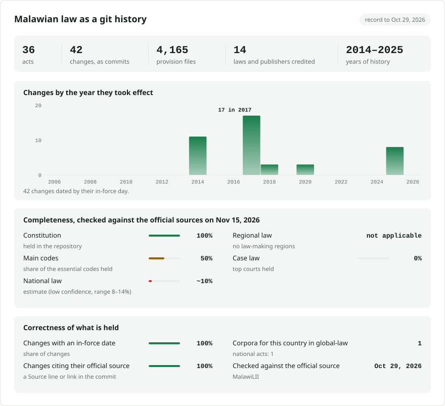

# Malawi: law history in git

<picture>
<source media="(prefers-color-scheme: dark)" srcset="data/effort-dark.svg">

</picture>

The law of Malawi as a git history: one file per section, one commit per version on the day it took effect, and the Act that made each change as the commit's author. `git blame` names the Act behind every paragraph; `git log` lists every change to a section; picking a date gives the text in force that day.

Part of [lexifina/global-law](https://github.com/lexifina/global-law), one git history for every country's law: this is Malawi's national law, which global-law reads at `malawi/national/acts/`.

**What is in it now:** the Constitution and 61 Acts of Parliament: 35 with their dated versions from MalawiLII (31 December 2014 to 5 September 2025), and 26 more as passed, secondary copies from FAOLEX and WIPO Lex (the Ministry of Justice's and the Judiciary's own files are consolidations with no day they are as at, scans, or Acts already held); and 15 pieces of subsidiary legislation. See [`STRUCTURE.md`](STRUCTURE.md) for the layout and [`REPRODUCE.md`](REPRODUCE.md) for the sources; [`data/laws.csv`](data/laws.csv) lists the Acts the MalawiLII versions name.

Each act is a folder `acts/<year>/<number>-<short title>/` (subsidiary legislation: `subsidiary/<year>/...`), with one file per section or schedule, plus `long-title.md` (`preamble.md` in the Acts added in November 2026) and a `README.md` listing its provisions and their changes (`acts/2000/006-employment-act/sec-044.md` is section 44 of the Employment Act, Act 6 of 2000, on annual leave; the Constitution is in `constitution/`).

The text is in English, as each source publishes it; for the MalawiLII acts its editorial notes (kept only where a provision has no other text) and the Part and Chapter headings are left out.

## Questions as git commands

| Question | Command |
| --- | --- |
| Every change to section 16 of the Constitution | `git log -p --word-diff -- constitution/sec-016.md` |
| Which Act wrote each line of section 16? | `git blame constitution/sec-016.md` |
| Every version of the Constitution, with the day each took effect | `git log --format="%h %(trailers:key=In-force,valueonly,separator=) %an" -- constitution ':!constitution/README.md'` |
| Section 16 as in force on 1 January 2026 | `python tools/on.py 2026-01-01 constitution sec-016` |
| Section 44 of the Employment Act, with its history across the move to `acts/` | `git log --follow -p -- acts/2000/006-employment-act/sec-044.md` |

**Outside git**, we also host this record publicly, for free:

- **[Ask Claude about Malawian law](https://global-law.lexifina.com/v1/try_claude?country=malawi)**: opens Claude with a first question ready.
- **[Ask ChatGPT](https://global-law.lexifina.com/v1/try_chatgpt?country=malawi)**: the same question in ChatGPT.
- **[Search Malawian law on our site](https://lexifina.com/law?country=malawi&q=annual+leave)**: a search for "annual leave", with each provision's text and its versions, no account needed.
- **[Developer REST API](https://global-law.lexifina.com/v1/search_law?query=annual+leave&jurisdiction=malawi)**: the same search as JSON, with no key. See the [documentation here](https://lexifina.com/api/global-law).

Both assistants read the record through the free Global law connector (MCP, `https://global-law.lexifina.com/mcp`); the first time, the chat gives you the link that adds it. Ask in English.

**Host it yourself easily.** All it takes is git and Python, and the tools run on your machine:

```sh
git clone --depth 1 https://github.com/lexifina/global-law && cd global-law
python3 tools/countries.py add malawi/national/acts
python3 tools/law.py show 2026-01-01 malawi/national/acts/constitution/sec-016.md
```

Opened in Claude Code, Cursor, VS Code or Codex, the clone also starts a local MCP server with the same tools ([MCP.md](https://github.com/lexifina/global-law/blob/main/MCP.md)).

## Dates

Each commit is dated at noon, Africa/Blantyre, on the day the version took effect, and carries it in its `In-force:` trailer, with the reason in `In-force-basis:` for the Acts added in November 2026 (an Act as passed: the commencement day printed under its long title, else its Gazette publication or the record's entry-into-force date). For the MalawiLII acts the day is MalawiLII's, the date of its point-in-time version (expression):

- for an amendment, the day it came into force, as MalawiLII's amendment list gives it ("[Amended by <Act> on <date>]");
- for a revised edition of the Laws of Malawi, the day the edition is as at: 31 December 2014 or 31 December 2017 (the Fifth Revised Edition) for most acts here;
- for an act as enacted, its Gazette publication, or the commencement day MalawiLII states where that is later (the Tax Administration Act 2021, published on 13 August 2021, is dated 1 April 2025).

Each change is credited to the amending Act MalawiLII's History names (`Act 13 of 2020`), and a provision only to an Act its editorial note names where one version takes in several. The first version of 7 acts is the act as enacted, credited to the act itself; for the other 29 it is the "oldest version available", credited to the publisher (`MalawiLII`).

## How it is checked

- For the 36 MalawiLII acts (checked before their folders moved to `acts/<year>/` on 27 November 2026), `tools/check_repo.py` reads every version back from git on the day it took effect and on the day before, and compares it with the corpus: 42 versions of 36 acts, 0 mismatches (see [`REPRODUCE.md`](REPRODUCE.md)).
- Every version is parsed from an archived copy of its own dated expression page, whose sha256 is recorded with it; the last version of each act is the one MalawiLII publishes as current, with no later amendment listed and none waiting to be applied.
- A second build from the same corpus gave identical hashes for all 42 history commits and 55 tags.
- History is append-only: no merge commits, and nothing is rewritten. The sources added on 27 November 2026 were appended after the earlier history, so from there commit dates restart at the oldest new version; use the `In-force:` trailer to read versions by date.
- [vulnerabilities/](vulnerabilities/): possible drafting mistakes in this law, found by global-law's detectors and checked by hand. Not run yet.

## What it does not show

- **Most Malawian law.** The Acts added as passed are those the Ministry of Justice, the Judiciary, FAOLEX and WIPO Lex hold with a text layer and a printed day, and an Act as passed is not updated by its later amendments. Not held: the Penal Code (the only open copies are a consolidation with no day it is as at), the Companies Act 2013 (no open copy found), the Courts Act, the Taxation Act and the Value Added Tax Act, most subsidiary legislation, and Parliament's Acts (parliament.gov.mw answers with a Cloudflare challenge). Scans without a text layer are held (no OCR). Case law is in a separate private repository.
- **Changes before MalawiLII's oldest version.** 29 acts start at a revised edition that already holds the earlier amendments; the Presidential, Parliamentary and Local Government Elections Act 2023 starts on 5 September 2025, after Act 32 of 2025, not as enacted.
- **Amendments MalawiLII has not recorded.** The acts whose only version is the 2014 or 2017 revised edition are the most exposed.
- **The amending Acts' assent and Gazette dates.** Only the day each change took effect is given.
- **Changes within a line.** Each paragraph is one line, so blame credits a whole paragraph; use `git log -p --word-diff` for the words.

## Sources

| Source | Kind | Past versions | Notes |
| --- | --- | --- | --- |
| [MalawiLII](https://malawilii.org) (Gender and Justice Unit, on the Laws.Africa Peachjam platform) | Legal information institute: consolidated acts | yes, each dated point-in-time version | The text, the day each version took effect, the History and amendment lists, and editorial notes naming the amending Acts |
| [Internet Archive](https://web.archive.org) | Archived copies of MalawiLII's pages | as archived | Every MalawiLII page was read from an archived copy |
| [Ministry of Justice](https://www.justice.gov.mw/index.php/resources/laws-and-regulations) | Official: Laws and Regulations | no | Acts as passed, dated by the day printed in them; consolidations with no as-at day are held |
| [Judiciary of Malawi](https://www.judiciary.mw/resources/legal-instruments/acts-of-parliament) | Official: Acts of Parliament | no | As for the Ministry of Justice |
| [FAOLEX](https://www.fao.org/faolex/) (FAO), listed through [ECOLEX](https://www.ecolex.org) | Secondary copy: Acts and subsidiary legislation | no | `Source-status: secondary copy`; used only where no official copy is held |
| [WIPO Lex](https://www.wipo.int/wipolex/) | Secondary copy: intellectual-property and trade law | no | `Source-status: secondary copy`; dates from its records |

## Licence

See [`LICENSE`](LICENSE), which lists each source's terms. The MalawiLII texts are under CC BY-NC 4.0 with MalawiLII credited as the source, so they may be used only for non-commercial purposes; neither MalawiLII nor Laws.Africa endorses this repository. FAOLEX texts are reused with credit to FAO for non-commercial purposes. Lexifina's arrangement, commit messages, tables and tools are CC0 1.0.

No AI model wrote, translated or corrected legal text, and none runs at build time; the scripts were written by an AI model (see [`REPRODUCE.md`](REPRODUCE.md)).

## Visualisations

- [visualisations/](visualisations/): charts drawn from this repository. Not drawn yet.

## More

From [lexifina/global-law](https://github.com/lexifina/global-law):

- [FEATURES.md](https://github.com/lexifina/global-law/blob/main/FEATURES.md): every feature, and what every corpus must support (`git blame`, `law.py`, the MCP tools)
- [FAQ.md](https://github.com/lexifina/global-law/blob/main/FAQ.md): questions and answers · [CONTRIBUTING.md](https://github.com/lexifina/global-law/blob/main/CONTRIBUTING.md): proposing changes · [MCP.md](https://github.com/lexifina/global-law/blob/main/MCP.md): the MCP server · [REPRODUCE.md](https://github.com/lexifina/global-law/blob/main/REPRODUCE.md): how it was built · [CHANGELOG.md](https://github.com/lexifina/global-law/blob/main/CHANGELOG.md)
- [FRESHNESS.md](https://github.com/lexifina/global-law/blob/main/FRESHNESS.md): how current each corpus is · [Monitoring](https://github.com/lexifina/global-law/tree/main/monitoring): whether updates are running · [WATCHING.md](https://github.com/lexifina/global-law/blob/main/WATCHING.md): how each official source is watched for changes
- [performance/](https://github.com/lexifina/global-law/tree/main/performance): how fast the tools are, measured
- [visualisations/](https://github.com/lexifina/global-law/tree/main/visualisations): charts and bridges across the world's law
- [Vulnerabilities](https://github.com/lexifina/global-law/tree/main/vulnerabilities): mistakes in legislation as published
